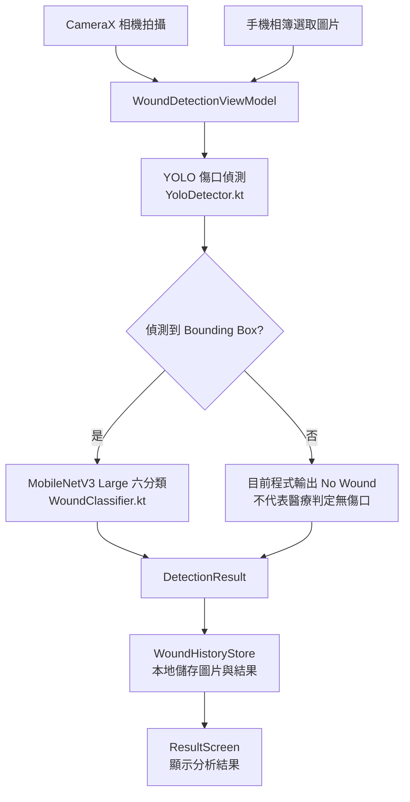

# 用於智慧型手機的端對端智慧型皮膚傷口偵測與分級系統

本系統旨在將原本仰賴雲端運算或人工目測的皮膚傷口評估流程，完整整合並部署於智慧型手機本地端，實現從「影像拍攝、傷口定位、邊界預測到嚴重程度分級」的一站式即時輔助診斷。

## 一、 端對端系統流程設計

整體推論管線（Pipeline）劃分為四個連續階段，皆於行動裝置本地端離線執行：

```text
[手機影像擷取與前處理] ──▶ [傷口偵測與邊界預測] ──▶ [傷口分級與特徵分類] ──▶ [臨床視覺化與追蹤輸出]
```

1. **影像擷取與前處理**
   * 透過手機鏡頭拍攝傷口影像，執行自動曝光／白平衡校正、尺規比例校準（供後續面積換算）與解析度正規化，有效降低病房與居家環境的光照干擾。
2. **傷口偵測與邊界預測（Detection & Segmentation）**
   * 快速定位傷口感興趣區域（ROI）並精準勾勒慢性潰瘍或傷口邊界，排除周圍健康皮膚與背景雜訊，同時計算傷口面積與長寬等量化指標。
3. **傷口分級與特徵分類（Grading & Classification）**
   * 針對裁切後的傷口區域進行嚴重程度分級（如壓傷分級或潰瘍分級），並辨識內部組織特徵（如肉芽組織、腐肉、壞死組織等）。
4. **臨床視覺化與追蹤輸出**
   * 於手機介面即時疊加預測邊界、分級結果與信心分數，並記錄歷次數據以追蹤傷口癒合趨勢。

## 二、 輕量化模型與手機端加速策略

為在智慧型手機有限的記憶體、算力與電池功耗下維持臨床級準確率，系統採用軟硬體協同的輕量化設計：

* **混合式輕量骨幹架構**：結合輕量級卷積網路與視覺轉換器的互補優勢——例如以 **MobileNetV3** 負責低延遲的局部空間特徵提取與初步偵測，搭配 **MViTv2** 等多尺度架構捕捉傷口紋理的長距離關聯與全域語意，在參數量與分級精度之間取得平衡。
* **模型壓縮與量化**：透過訓練後量化（PTQ）或量化感知訓練（QAT）將權重壓縮至 **INT8 / FP16**，並結合通道剪枝（Pruning），顯著縮小模型體積與記憶體頻寬佔用。
* **端側推論引擎部署**：將訓練完成的模型匯出為 **ONNX**、**TFLite** 或 **CoreML** 格式，調用手機內建的 NPU／GPU 進行硬體加速，確保單張影像推論達毫秒級回應。

## 三、 臨床落地優勢與關鍵挑戰對策

將整套推論流程留置於手機端，不僅能確保病患敏感的傷口影像落地(完全離線推論) 以符合醫療隱私規範，也能在無網路的巡房或居家照護情境下，提供客觀且一致的量化評估基準，協助醫師與傷口護理師減輕紀錄負擔。

| 實務挑戰 | 技術對策 |
| :--- | :--- |
| **拍攝環境與光線變異** | 訓練階段導入多樣化資料擴增（色彩抖動、亮度調整、旋轉與仿射變換），搭配推論前的自動色彩校正。 |
| **慢性傷口邊界模糊** | 採用邊界感知損失函數（Boundary-aware Loss）強化邊緣梯度學習，並結合第一線臨床人員的標註回饋進行迭代修正。 |
| **各分級樣本數量不平衡** | 使用 Focal Loss、類別權重調整或針對少數分級類別進行重點資料擴增，避免模型偏向多數類別。 |
| **手機端發熱與續航限制** | 結合動態解析度縮放與事件觸發式推論（僅在畫面對焦穩定時執行模型推論），降低持續運算功耗。 |

# 專案說明
## Wound Detection 傷口偵測
```text
Detection/
├── wound_detection.py   # 傷口偵測

```
第一階段：傷口部位偵測與特徵裁切（Wound Detection & Context-Aware Cropping）

透過 Ultralytics 框架載入訓練完成的目標偵測模型（測試與部署階段採用輕量高效的 YOLO26s，實驗階段亦評估 RT-DETR-L 架構），對輸入影像進行傷口位置偵測。

## Wound Classification 傷口分類
第二階段：傷口等級分類（Wound Classification）

讀取第一階段裁切出的傷口影像，經由標準化前處理（縮放至 256、中心裁切至 224×224 及 ImageNet 正規化）後，輸入微調過的 MobileNetV3-Large 分類模型。

模型將傷口自動歸類為 6 個類別：WCC_0、WCC_1、WCC_2、WCC_3、WCC_4 與 other，並自動將圖片分類歸檔至對應資料夾，同時記錄推論耗時與每秒處理張數（FPS）。

本專案採用模組化架構設計，將影像分類任務拆分為資料擴增、模型定義、超參數調校、模型訓練與推論部署五個獨立模組，方便維護、除錯與後續擴充。

### 目錄結構

```text
Classification/
├── data_augment.py   # 資料擴增模組
├── tool.py           # 模型定義與輔助工具
├── optim.py          # 最佳學習率搜尋
├── train.py          # 模型訓練主程式
└── Inference.py      # 模型推論與預測
```

### 檔案與模組說明

| 檔案名稱 | 模組角色 | 核心功能說明 |
| :--- | :--- | :--- |
| `data_augment.py` | **資料擴增** | 負責訓練前的資料增強處理（如旋轉、翻轉、縮放、色彩抖動或正規化），用以擴充樣本多樣性、防止模型過擬合並提升泛化能力。 |
| `tool.py` | **模型定義檔** | 封裝分類模型的神經網路架構（Backbone 與分類頭）及相關輔助函式，供 `train5.py`、`optim.py` 與 `Inference.py` 統一匯入呼叫。 |
| `optim.py` | **學習率搜尋** | 實作最佳學習率尋找機制（如 Learning Rate Finder），透過動態遞增學習率並觀察 Loss 變化曲線，協助在正式訓練前選定合適的初始學習率。 |
| `train5.py` | **模型訓練主程式** | 整合資料載入、模型初始化、Loss 計算與反向傳播更新，執行完整的訓練與驗證迴圈（Training / Validation Loop），並儲存表現最佳的模型權重。 |
| `Inference.py` | **模型推論** | 載入 `tool.py` 的模型結構與 `train.py` 產出的權重檔，對新輸入的測試影像進行前處理與前向傳遞，並輸出預測類別與信心分數。 |

### 標準執行流程（Workflow）
1. **資料準備與擴增**：透過 `data_augment.py` 產生或即時套用擴增後的訓練資料集。
2. **確認模型結構**：在 `tool.py` 中設定目標分類網路架構與輸出類別數（`num_classes`）。
3. **尋找最佳學習率**：執行 `optim.py` 評估模型在當前資料集上的收斂區間，取得建議的學習率參數。
4. **啟動模型訓練**：將最佳學習率填入 `train.py` 並開始訓練，輸出並保存最佳權重檔（如 `.pth` 或 `.pt`）。
5. **執行推論預測**：使用 `Inference.py` 載入權重檔，對未知資料進行分類預測與效能評估。

### 快速開始（範例指令）

```bash
# 1. 資料擴增（若為離線擴增）
python data_augment.py

# 2. 尋找最佳學習率
python optim.py

# 3. 執行模型訓練
python train.py

# 4. 執行模型推論
python Inference.py
```

## Inference 模型推論
對應檔案：`wound_inference.py`

負責自動化兩階段端到端（End-to-End）推論流程，將「傷口偵測定位」與「傷口等級分類」串接為單一執行腳本。

* **第一階段：偵測與上下文擴大裁切（`detection()`）**
  * 載入 `YOLO26s` 最佳權重對測試影像執行偵測，並輸出測試指標與預測結果。
  * **上下文保留策略**：裁切時以 Bounding Box 中心點為基準，將**寬度與高度各放大 2 倍**（並自動限制在原圖邊界內），藉此保留傷口周圍皮膚組織特徵，提供下一階段分類模型更完整的判斷依據。
* **第二階段：傷口等級分類與自動歸檔（`classification()`）**
  * 載入微調後的 **MobileNetV3-Large** 分類模型權重，對裁切影像進行標準前處理（Resize `256`、CenterCrop `224x224`、ImageNet 正規化）。
  * 自動將傷口辨識並歸檔至 6 個類別資料夾：`WCC_0`、`WCC_1`、`WCC_2`、`WCC_3`、`WCC_4` 與 `other`。
* **防呆機制與效能基準測試**
  * 在分類前加入路徑檢查與「零偵測防呆（Fail-Fast）」，避免前階段無偵測輸出時造成後續流程異常。
  * 分類完成後透過 `DataLoader` 進行推論效能基準測試，統計整體準確率、平均批次耗時與每秒處理張數（FPS），並保留影像張量與預測結果以利後續分析（如 Grad-CAM 視覺化或錯誤案例檢視）。

## LiteRTTest — Android On-device Wound Detection & Classification
本專案使用 **Android Studio、Kotlin、Jetpack Compose、CameraX** 與 **Google AI Edge LiteRT**，在 Android 智慧型手機上整合「影像擷取 → 傷口位置偵測 → WCC 六分類 → 結果呈現與歷史紀錄」流程。使用者可直接拍攝傷口照片，或從手機相簿選取圖片，在裝置本地端執行 AI 模型推論。

> **專案狀態：研究原型／持續開發中。** 目前傷口偵測採用 **Bounding Box**，尚未實作像素級傷口分割、實際面積量測或經臨床驗證的診斷。AI 結果僅供研究與輔助觀察，不能取代醫師或專業醫護人員判斷。

### 一、系統架構與端對端流程



**目前程式的實際行為：** YOLO 找到至少一個傷口框後，`WoundDetectionViewModel.kt` 將**原始完整 Bitmap** 傳給 MobileNetV3 分類器。**尚未**實作「依 YOLO 框裁切 ROI、再將框寬高擴大 2 倍後分類」的流程，請勿與 Python 訓練／推論專案混淆。

模型推論程式在 Android 本地端使用 `.tflite` 檔案；本 README 不宣稱已完成臨床等級驗證或所有離線／隱私安全性測試。

### 二、技術架構與開發環境

| 類別 | 使用技術／目前設定 |
|---|---|
| 平台 | Android，**minSdk 29**（Android 10 以上） |
| 開發環境 | Android Studio、**Kotlin 2.0.0（Version Catalog 宣告）**；程式碼 Java 11 相容設定；**Gradle 執行環境需 JDK 17 或以上** |
| UI | Jetpack Compose、Material Design 3（Compose BOM：`2026.05.00`，以 `app/build.gradle.kts` 為準） |
| 相機 | CameraX 1.3.3 |
| 頁面導覽 | Navigation Compose 2.8.1 |
| 狀態管理 | AndroidX ViewModel、Compose State、Coroutines |
| AI Runtime | Google AI Edge LiteRT **2.1.5** |
| AI 模型格式 | TensorFlow Lite（`.tflite`） |
| 圖片保存 | MediaStore、APP 私有檔案空間 |
| 歷史紀錄 | SharedPreferences + JSON + JPEG |
| 其他已宣告依賴 | Room 2.6.1（**尚未用於目前病患／歷史資料儲存**）、Coil 2.4.0 |
| Android Build | **Android Gradle Plugin 9.0.0**、**Gradle Wrapper 9.3.1**；`compileSdk = 36`、`targetSdk = 36`、`versionName = "1.0"` |
| Android SDK | **Android SDK Platform 36**；AGP 9.0 所需 SDK Build Tools **36.0.0**（可由 SDK Manager / Gradle 安裝） |
| KSP | **2.0.0-1.0.24**（由 Version Catalog 宣告） |
| Compose BOM | **`2026.05.00`**（`app/build.gradle.kts` 實際宣告的 BOM） |
| Version Catalog 中的其他版本 | `coreKtx = 1.15.0`、`activityCompose = 1.10.1`、`lifecycleRuntimeKtx = 2.8.7`、`composeBom = 2024.09.00` |

> **建置相容性：** AGP 9.0 官方最低要求 Gradle 9.1.0、JDK 17、SDK Build Tools 36.0.0；目前 Wrapper 宣告 Gradle 9.3.1，符合 Gradle 最低版本要求。`compileOptions` 設定的 Java 11 指的是原始碼／位元碼相容性，**不是**執行 Gradle 所需的 JDK 版本。這些資訊不能取代實際 Gradle Sync / Build 測試。

> **版本來源與差異：** Kotlin `2.0.0`、AGP `9.0.0`、KSP `2.0.0-1.0.24` 是依 `gradle/libs.versions.toml` 確認。AGP 9.0 具備內建 Kotlin 支援，實際解析的 Kotlin Gradle Plugin / KSP 版本可能與 Version Catalog 宣告版本不同；應以 Gradle 依賴解析或 Sync 結果確認。Version Catalog 的 `composeBom = 2024.09.00` 與 `app/build.gradle.kts` 直接宣告的 `androidx.compose:compose-bom:2026.05.00` **不同**；目前此模組的主要 Compose BOM 實際引用後者，README 不將兩個版本混為一談。另 `app/build.gradle.kts` 重複宣告部分依賴（例如 Core KTX 與 Material3），留待建置驗證後再調整。上述均為**專案中宣告的版本**，並非最新穩定版的保證。

### 三、傷口偵測（Wound Detection）

**程式位置：** `app/src/main/java/com/example/literttest/ml/YoloDetector.kt`

**目前載入模型：** `app/src/main/assets/yolo_no_nms_best_float32.tflite`

主要流程如下：

1. 讀入相機拍攝或相簿選取的 `Bitmap`。
2. 保留長寬比縮放，**Letterbox 至 640 × 640**，填充色為 RGB `(114, 114, 114)`。
3. 轉換為 **RGB、Float32、NHWC** 排列，像素數值除以 255。
4. 使用 LiteRT 推論，**GPU 優先；GPU 初始化失敗則改為 CPU**。
5. 依程式目前設定的單類 YOLO `[1, 5, N]` 格式解析框位置與信心分數。
6. 以 `Confidence ≥ 0.15` 過濾候選框，再以 `IoU = 0.45` 執行 NMS。
7. 若完整照片沒有偵測到框，對照片**中央 65% 區域**進行第二次偵測；找到框時將座標還原至原圖。

> **已知限制：** `[1, 5, N]` 等 Tensor 規格目前是 Android 程式中的解析假設，仍須直接檢查模型輸入／輸出 Tensor Metadata。已有實測顯示部分明顯有傷口的照片仍會漏偵測，因此不應將零個偵測框視為「確認無傷口」。

### 四、WCC 六分類（Wound Classification）

**程式位置：** `app/src/main/java/com/example/literttest/ml/WoundClassifier.kt`

**目前載入模型：** `app/src/main/assets/mobilenetv3_large_6class_float32.tflite`

分類器使用 **MobileNetV3 Large**，輸入前處理為：

```text
Input Bitmap
  ↓
Resize：短邊縮放至 256
  ↓
Center Crop：224 × 224
  ↓
RGB Float32 + ImageNet Mean / Std 正規化
  ↓
LiteRT 推論（目前固定 CPU）
  ↓
6 個 Logits → Softmax → 預測類別與六類機率
```

程式中定義的分類索引順序：

| Index | 類別 |
|---:|---|
| 0 | `OTHER` |
| 1 | `WCC_0` |
| 2 | `WCC_1` |
| 3 | `WCC_2` |
| 4 | `WCC_3` |
| 5 | `WCC_4` |

> 類別索引仍應與訓練端的 `class_to_idx` 再次核對。六分類推論程式已實作，但尚未以完整的 Android 真實傷口測試紀錄驗證端對端準確率。WCC 標籤也不應自行等同於臨床分級結論。

### 五、主要功能（Features）

| 功能 | 主要檔案 | 目前狀態 |
|---|---|---|
| 首頁與功能入口 | `ui/screens/HomeScreen.kt` | 已實作五個入口：相機、上傳、病患、歷史、設定 |
| 即時相機預覽與拍照 | `ui/screens/CameraScreen.kt` | CameraX 黑屏問題已有修復測試紀錄；支援權限、旋轉校正與相簿保存 |
| 相簿圖片選擇與分析 | `ui/screens/UploadScreen.kt` | 已實作；使用 Android 本地圖片選取器 |
| YOLO + MobileNet 推論控制 | `ui/viewmodel/WoundDetectionViewModel.kt` | 已串接兩階段呼叫、推論互斥、結果及歷史保存 |
| AI 結果顯示 | `ui/screens/ResultScreen.kt` | 已實作圖像疊框、分類、信心分數與耗時顯示；存在待修正 UI 問題 |
| 歷史紀錄 | `ui/screens/HistoryScreen.kt` | 已實作新增、查看、詳細報告與刪除；**不使用 Room** |
| 病患管理 | `ui/screens/PatientScreen.kt` | **原型**：目前為模擬清單與記憶體新增，無永久儲存或病患關聯 |
| APP 設定 | `ui/screens/SettingsScreen.kt` | **原型**：滑桿、深色模式、語言、自動儲存尚未連動實際功能 |
| 擴充分析頁面 | `ui/screens/AnalysisScreen.kt` | 已有頁面程式；目前未註冊在 `MainActivity` 導覽中 |
| 健康建議頁面 | `ui/screens/SuggestionScreen.kt` | 檔案存在；目前未註冊在 `MainActivity` 導覽中 |
| 進階效能測試引擎 | `ml/InferenceEngine.kt`、`ui/viewmodel/AnalysisViewModel.kt` | **原型／佔位程式**；不能當作已完成的正式推論流程 |

### APP 導覽路由

目前 `MainActivity.kt` 註冊的路由如下：

```text
home（首頁）
 ├── camera（相機偵測） ─┐
 ├── upload（相簿上傳） ─┴── result（結果頁）
 ├── patients（病患管理）
 ├── history（歷史紀錄）
 └── settings（設定）
```

`AnalysisScreen.kt` 中雖有前往 `suggestion` 的按鈕，但目前 `MainActivity.kt` 未註冊 `analysis` 或 `suggestion` 路由，因此這兩個頁面**不應標示為已能由正式導航進入**。

### 六、專案目錄結構（Project Structure）

以下是依已提供的 Android Studio 專案截圖與主要 Kotlin 原始碼整理的**主要檔案結構**。部分非核心資源檔未逐一列出。

```text
LiteRTTest/
├── README.md
├── build.gradle.kts                     # 根專案 Gradle Plugins
├── app/
│   ├── build.gradle.kts                 # SDK、依賴與建置設定
│   └── src/main/
│       ├── AndroidManifest.xml          # APP 權限與元件宣告
│       ├── assets/                      # 手機端 AI 模型
│       │   ├── yolo_no_nms_best_float32.tflite
│       │   ├── yolo26s_wound_float32.tflite
│       │   ├── mobilenetv3_large_6class_float32.tflite
│       │   ├── mobilenetv3_large_93acc.tflite
│       │   ├── mobilenetv3_large_Acc76_V2.tflite
│       │   └── torchvision_mobilenet_v3_small_fp32.tflite
│       ├── java/com/example/literttest/
│       │   ├── MainActivity.kt          # APP 入口、NavHost
│       │   ├── BoxOverlayView.kt        # 傷口框疊加相關元件
│       │   ├── ml/
│       │   │   ├── YoloDetector.kt      # YOLO 偵測、Letterbox、NMS
│       │   │   ├── WoundClassifier.kt   # MobileNetV3 六分類
│       │   │   ├── WoundBox.kt          # 偵測框資料結構
│       │   │   ├── DetectionResult.kt   # 推論結果資料結構
│       │   │   └── InferenceEngine.kt   # 尚未完成的測試推論引擎
│       │   └── ui/
│       │       ├── components/
│       │       │   └── BottomNavBar.kt
│       │       ├── screens/
│       │       │   ├── HomeScreen.kt
│       │       │   ├── CameraScreen.kt
│       │       │   ├── UploadScreen.kt
│       │       │   ├── ResultScreen.kt
│       │       │   ├── HistoryScreen.kt # 含 WoundHistoryStore
│       │       │   ├── PatientScreen.kt
│       │       │   ├── SettingsScreen.kt
│       │       │   ├── AnalysisScreen.kt
│       │       │   └── SuggestionScreen.kt
│       │       ├── viewmodel/
│       │       │   ├── WoundDetectionViewModel.kt
│       │       │   └── AnalysisViewModel.kt
│       │       └── theme/
│       │           ├── Color.kt
│       │           ├── LitertTestTheme.kt
│       │           ├── Theme.kt
│       │           └── Type.kt
│       └── res/
│           ├── drawable/
│           ├── layout/
│           └── mipmap-*/
└── gradle/
    ├── libs.versions.toml              # AGP / Kotlin / KSP / 部分依賴的版本目錄
    └── wrapper/
        └── gradle-wrapper.properties   # 指定 Gradle 9.3.1
```

已確認 `data/db/`、`data/repository/`、`ui/navigation/` 與 `utils/` 是空資料夾，因此沒有將其描述成已完成的實作模組；Git 本身也不會追蹤純空資料夾。

### AI 模型檔案用途

| 模型 | 目前定位 |
|---|---|
| `yolo_no_nms_best_float32.tflite` | **正式兩階段流程目前使用的 YOLO 模型** |
| `mobilenetv3_large_6class_float32.tflite` | **正式兩階段流程目前使用的 MobileNet 六分類模型** |
| `mobilenetv3_large_93acc.tflite` | `InferenceEngine.kt` 有引用，但該引擎推論函式目前仍為佔位實作 |
| `yolo26s_wound_float32.tflite` | 存在於 assets；在已檢查的正式 ViewModel 偵測路徑中未使用 |
| `mobilenetv3_large_Acc76_V2.tflite` | 舊版模型（不作為目前六分類正式流程模型） |
| `torchvision_mobilenet_v3_small_fp32.tflite` | 存在於 assets；目前正式流程未使用 |

### 七、本地影像與歷史紀錄儲存

#### 相機拍攝照片

由 `CameraScreen.kt` 使用 Android MediaStore 存入：

```text
Pictures/WoundDetection/
└── WoundPhoto_yyyyMMdd_HHmmss.jpg
```

#### 分析歷史紀錄

由 `HistoryScreen.kt` 中的 `WoundHistoryStore` 保存：

```text
APP 私有儲存空間（示意）
├── shared_prefs/
│   └── wound_history.xml        # SharedPreferences 中的 JSON 紀錄
└── files/
    └── wound_history/
        ├── <UUID>.jpg
        └── <UUID>.jpg
```

紀錄包含時間、圖片來源、預測類別、分類機率、YOLO 偵測框、推論耗時等資訊。目前病患清單**尚未與歷史紀錄關聯**。

> 上述是 Android 裝置內的資料位置，不是 GitHub Repository 資料夾。**請勿將真實病患姓名、傷口照片或其他敏感個資上傳至公開 GitHub。**

### 八、快速開始（Getting Started）

1. 將 Repository 下載或 Clone 到本機，使用 **Android Studio** 開啟 `LiteRTTest/` 專案根目錄（原開發電腦的已知位置：`D:\weizhi\LiteRTTest\LiteRTTest`；其他電腦請以實際 Clone 位置為準）。
2. 在 Android Studio 的 **Settings → Languages & Frameworks → Android SDK**（或 SDK Manager）安裝 **Android SDK Platform 36**，確認有 **Android SDK Build-Tools 36.0.0** 與 **Android SDK Platform-Tools**。設定 **Gradle JDK 17 或以上**（與程式碼的 Java 11 相容設定是不同概念），再執行 Gradle Sync。**不需要僅因 `minSdk = 29` 而安裝 SDK Platform 29。**
3. 確認 `app/src/main/assets/` 至少包含目前正式使用的兩個模型：
   - `yolo_no_nms_best_float32.tflite`
   - `mobilenetv3_large_6class_float32.tflite`
4. 連接 Android 10（API 29）以上的實體手機，或使用符合條件的測試裝置，在 Android Studio 按 **Run** 安裝 APP。
5. 進入 APP 後選擇「相機偵測」或「上傳分析」。使用相機時需授權相機權限。
6. 透過 **Logcat** 觀察 `YoloDetector`、`WoundClassifier`、`WoundDetectionVM`、`CameraScreen` 等標籤，確認模型初始化及結果。

> 如果 Gradle Sync 有問題，請先核對 AGP `9.0.0`、Version Catalog 宣告的 Kotlin `2.0.0`、KSP `2.0.0-1.0.24`、Gradle Wrapper `9.3.1` 與 Compose BOM 的相容性，再決定是否調整版本；不建議直接升級所有依賴。目前提供的是設定檔，**不代表已在此處重新完成 Gradle Sync／Build 驗證**。

### 九、目前限制與後續工作（Roadmap）

- [ ] **優先修復 YOLO 漏偵測**：核對真實 Tensor Shape、前處理與輸出解析，使用同一張照片比較原始模型和 TFLite。
- [ ] 驗證 MobileNet 的 `class_to_idx` 與真實傷口圖片上的六分類結果。
- [ ] 評估並實作 YOLO ROI 裁切／擴大上下文後再送入分類模型；目前正式程式使用原圖分類。
- [ ] 修正零偵測時的 `No Wound` 表述，避免誤認為臨床確診無傷口。
- [ ] 修正 `ResultScreen.kt` 的圖片裁切與 Bounding Box 對齊、`WCC_4`／`OTHER` 顯示問題（**尚未確認已套用修正**）。
- [ ] 將 `SettingsScreen` 的信心度、主題、語言、自動儲存設定連動到實際功能並持久化。
- [ ] 完善病患管理的永久儲存、資料編輯與歷史紀錄關聯。
- [ ] 確認 Navigation 返回操作、`AnalysisScreen`／`SuggestionScreen` 導航及崩潰問題。
- [ ] 建立固定測試影像集，評估 Recall、Precision、分類表現與端側推論耗時。

### 十、開發狀態與使用聲明

本專案為研究與原型開發用途。目前 **CameraX 拍照、相簿上傳、YOLO 推論呼叫、分類器實作、結果展示及本地歷史紀錄** 均已有程式支援；部分已在手機上取得成功的測試紀錄，但尚未完成全面的端對端驗證及臨床驗證。

**請勿以此 APP 的結果作為獨立醫療診斷、治療或傷口嚴重程度判定依據。**

---

*本 README 依截至 2026-11-25 已提供的 Android 專案截圖、Kotlin 程式碼、`app/build.gradle.kts` 與 `gradle/libs.versions.toml`、`gradle/wrapper/gradle-wrapper.properties` 編寫；尚未檢查的檔案與未實機驗證的功能，均以保留或待確認的方式描述。*
